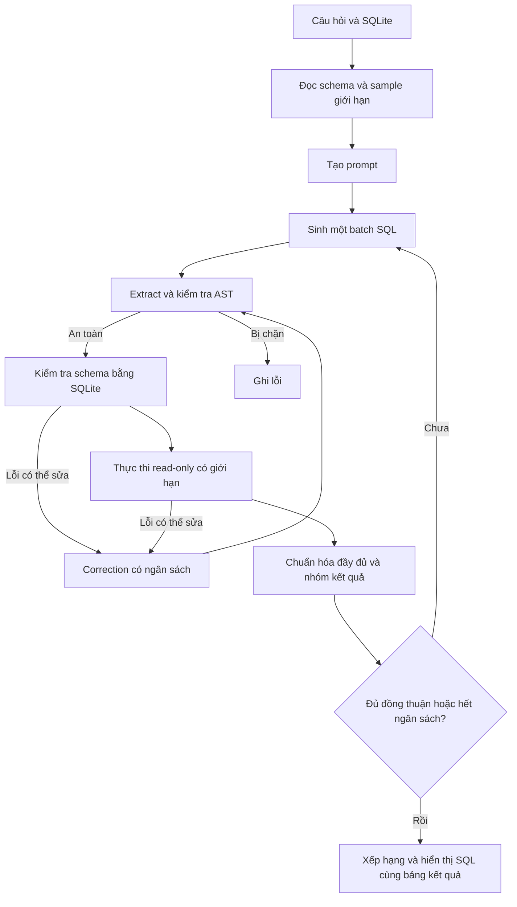

# Adaptive SLM SQL

**Mới clone repo?** Xem [SETUP.md — cài đặt, tải model và chạy từ đầu](SETUP.md).

Ứng dụng local chuyển câu hỏi tiếng Việt/tiếng Anh thành SQL trên SQLite. Pipeline đọc schema, sinh SQL, kiểm tra, thực thi và chọn ứng viên dựa trên kết quả. Có giao diện Streamlit và CLI thực nghiệm.

**Chạy nhanh trên máy hiện tại:** mở `scripts/run_demo.bat`. Môi trường `.venv` đã được tạo trong project. Mặc định dùng **huggingface**, model **SLM-SQL-1.5B**, thiết bị **auto** (ưu tiên GPU) và phương pháp **greedy**. Nhập câu hỏi tiếng Việt/tiếng Anh → **Generate SQL**, hoặc chọn câu hỏi mẫu → **Dùng câu hỏi mẫu** → **Generate SQL**. Lần đầu bấm sẽ tải model vào bộ nhớ; các câu sau dùng lại model. Có thể chuyển sang `adaptive_sc` để thử nhiều ứng viên, thời gian chạy sẽ tăng.

Weights mặc định được lưu trong `models/SLM-SQL-1.5B` bên trong project, dùng chung cho script tải và UI/CLI. Cấu hình `local_files_only: true` dùng model đã tải, không cần mạng khi demo. Backend `huggingface` tự sinh SQL từ câu hỏi và schema, không tra đáp án fixture. Chất lượng câu trả lời cần kiểm tra; SQL thực thi thành công chưa chắc đúng ý nghĩa. Backend `mock` vẫn có thể chọn riêng để kiểm thử giao diện.

## 1. Phạm vi và cơ sở nghiên cứu

Project triển khai inference bằng model đã huấn luyện, không huấn luyện SFT/GRPO. Phương pháp thử nghiệm là lấy mẫu theo vòng `[4, 4, 8, 16]`, dừng khi có đủ ứng viên hợp lệ và đồng thuận, kết hợp kiểm tra schema và sửa SQL lỗi. Mục tiêu thực nghiệm là đo khả năng giảm số lần sinh và độ trễ so với lấy mẫu cố định, đồng thời theo dõi độ chính xác.

Tham khảo [bài báo SLM-SQL, Findings IJCNLP-AACL 2025](https://aclanthology.org/2025.findings-ijcnlp.92.pdf), [repository tác giả](https://github.com/CycloneBoy/slm_sql) và [model card 0.5B](https://huggingface.co/cycloneboy/SLM-SQL-0.5B). Đã kiểm tra ngày 10/09/2026: repository chưa cung cấp pipeline inference hoàn chỉnh; model card cho biết model thuộc họ Qwen2.5-Coder. Tokenizer config dùng `Qwen2Tokenizer`, chat template ChatML, hỗ trợ `add_generation_prompt`.

Prompt trong `core/prompt_builder.py` là bản tự viết dựa trên cấu trúc Phụ lục E.1: engine, schema, evidence và question. Đầu ra yêu cầu `<answer>...</answer>`. Khác với prompt nghiên cứu, ứng dụng yêu cầu SQL duy nhất và không yêu cầu xuất quá trình suy luận. Nếu model vẫn trả `<think>`, parser bỏ phần đó; UI/trace không xuất raw output. Vì khác prompt và chế độ inference, không xem project là bản tái hiện điểm số bài báo.

Correction là sửa một SQL lỗi bằng generation model, khác bước CSC so sánh hai nhóm ứng viên của bài báo. Interface cho phép truyền `correction_backend` riêng vào `Pipeline`; bản CLI/UI dùng generation model. Không tích hợp bước merge CSC trong bản demo này.

## 2. Pipeline



## 3. Tính năng

- Greedy một ứng viên; fixed SC với K; adaptive SC theo các vòng.
- SQLite mẫu hoặc upload `.db`/`.sqlite` tối đa 20 MB.
- Schema có cột, kiểu, PK, FK và mẫu giá trị. Tên bảng/cột ASCII, dữ liệu và câu hỏi tiếng Việt.
- SQLGlot parse AST; chặn ghi, multi-statement, bảng hệ thống, database ngoài, hàm ngoài allowlist.
- SQLite `mode=ro`, `query_only`, `trusted_schema=OFF` và authorizer độc lập ở executor.
- SQLite prepare kiểm tra bảng/cột/alias/CTE/subquery; JOIN có cảnh báo về tính đúng nghiệp vụ.
- Timeout, progress handler, giới hạn kích thước và số dòng kết quả.
- Bảng SQL ứng viên, phiếu, điểm, lỗi, sửa lỗi; trace từng vòng; xuất JSON/CSV.
- CLI đánh giá, ablation sáu cấu hình và ba biểu đồ PNG.
- Mock không tải model; unit tests và Streamlit AppTest không cần model thật.

## 4. Cấu trúc

```text
adaptive-slm-sql/
  app.py
  README.md
  config.yaml
  requirements.txt
  requirements-model.txt
  requirements-gpu.txt
  pyproject.toml
  Dockerfile
  .env.example
  .streamlit/config.toml
  core/
    config.py                 types.py
    model_backend.py          hf_model.py              mock_model.py
    schema_inspector.py       schema_selector.py       prompt_builder.py
    sql_extractor.py          sql_generator.py         sql_validator.py
    sql_executor.py           result_normalizer.py     result_grouper.py
    candidate_ranker.py       adaptive_sampler.py      sql_corrector.py
    pipeline.py
  databases/
    create_student_db.py      student_management.db
  data/
    demo_questions.json       evaluation_questions.json
  evaluation/
    metrics.py                evaluate.py
    run_ablation.py           plot_results.py
    run_sweep.py              plot_sweep.py
    sweep_report.py
  docs/results/               biểu đồ và sweep.csv của mục Số liệu kết quả
  scripts/
    download_model.py         smoke_test.py
    run_demo.bat              import_bird.py
  tests/
    conftest.py               test_schema_inspector.py
    test_sql_extractor.py     test_sql_validator.py    test_sql_executor.py
    test_result_grouper.py    test_adaptive_sampler.py test_pipeline_mock.py
    test_app.py
  results/
```

## 5. Phần cứng và Python

Python **3.11 hoặc 3.12**. Đã dùng Python 3.12 của máy để kiểm thử. Không chọn Python 3.10 vì executor dùng API `sqlite3.Connection.setlimit` từ Python 3.11.

Mock chỉ cần CPU; nên có 4 GB RAM. Model 0.5B trên CPU FP32 cần khoảng vài GB cho weights và runtime; nên có 8 GB RAM trở lên và vài GB đĩa trống cho cache. GPU 4 GB có thể thử batch 1–2, prompt ngắn, FP16; đây là cấu hình khởi đầu, không bảo đảm mọi truy vấn vừa bộ nhớ. Model 1.5B cần nhiều bộ nhớ hơn. CPU có thể chậm khi sinh nhiều ứng viên.

## 6. Setup Windows PowerShell từ đầu

Cài Python 3.11 từ [python.org](https://www.python.org/downloads/), bật tùy chọn thêm Python vào PATH. Mở PowerShell mới, chuyển vào thư mục project. Trên workspace hiện tại:

```powershell
cd 'C:\Users\Laptop\Desktop\HOC TAP CUC MANH\httm\SLM-PRJ\adaptive-slm-sql'
py -3.11 -m venv .venv
.\.venv\Scripts\Activate.ps1
python -m pip install -r requirements.txt
python databases/create_student_db.py
python -m pytest -q
python scripts/smoke_test.py --backend mock
python -m streamlit run app.py
```

Nếu đã có `.venv` trong project, bỏ qua lệnh tạo venv. Nếu chỉ cài Python 3.12, thay `py -3.11` bằng `py -3.12`. Nếu PowerShell chặn activate, không cần đổi policy: dùng đường dẫn Python trực tiếp:

```powershell
.\.venv\Scripts\python.exe -m pip install -r requirements.txt
.\.venv\Scripts\python.exe databases/create_student_db.py
.\.venv\Scripts\python.exe scripts/smoke_test.py --backend mock
.\.venv\Scripts\python.exe -m streamlit run app.py
```

Mở `http://127.0.0.1:8501` trong trình duyệt. Có thể chạy `scripts\run_demo.bat`; script dùng Python trong venv, tạo DB nếu thiếu và mở server local. Database đã có sẽ được giữ nguyên, không bị reset dữ liệu.

### Model thật trên CPU

Trong venv đã activate:

```powershell
python -m pip install torch==2.6.0 --index-url https://download.pytorch.org/whl/cpu
python -m pip install -r requirements-model.txt
$env:HF_HOME = "$PWD\.cache\huggingface"
python scripts/download_model.py
python scripts/smoke_test.py --backend huggingface --device cpu --mode greedy
python -m streamlit run app.py
```

Trên UI chọn backend `huggingface`, device `cpu`, phương pháp `greedy` để thử trước. `requirements.txt` cố ý không kéo PyTorch, để mock nhẹ. `.env.example` chỉ là ví dụ; chương trình không tự đọc file `.env`. `HF_HOME` cần được đặt trong shell như trên.

### Model thật trên NVIDIA CUDA

[Trang cài các phiên bản PyTorch](https://pytorch.org/get-started/previous-versions/) cung cấp wheel CPU và CUDA. Ví dụ cho CUDA 11.8, cần driver tương thích:

```powershell
python -m pip install --force-reinstall torch==2.6.0 --index-url https://download.pytorch.org/whl/cu118
python -m pip install -r requirements-model.txt
python -c "import torch; print(torch.__version__); print(torch.cuda.is_available())"
python scripts/smoke_test.py --backend huggingface --device cuda --mode greedy
```

Không cần cài torchvision/torchaudio cho project. Dòng “CUDA Version” trong `nvidia-smi` không đồng nghĩa đã cài PyTorch CUDA. Project không tự thay driver.

Quantization tùy chọn:

```powershell
python -m pip install -r requirements-gpu.txt
```

Chọn `4bit` hoặc `8bit` trong UI. CPU tắt quantization và dùng FP32. Nếu backend bitsandbytes không khả dụng/tương thích, chương trình báo cảnh báo và thử dtype thường. Nếu hết VRAM, giảm batch hoặc chuyển CPU.

### Đổi model 1.5B

Đổi Model ID thành `cycloneboy/SLM-SQL-1.5B` trong UI hoặc `config.yaml`:

```powershell
python scripts/download_model.py --model-id cycloneboy/SLM-SQL-1.5B
python -m evaluation.evaluate --backend huggingface --model-id cycloneboy/SLM-SQL-1.5B --mode greedy --limit 1
```

## 7. Linux/macOS và notebook

```bash
cd adaptive-slm-sql
python3.11 -m venv .venv
source .venv/bin/activate
python -m pip install -r requirements.txt
python databases/create_student_db.py
python -m pytest -q
python scripts/smoke_test.py --backend mock
python -m streamlit run app.py
```

Linux CPU: dùng wheel CPU như Windows. macOS: `python -m pip install torch==2.6.0` rồi cài `requirements-model.txt`; bản demo chạy CPU, chưa có backend MPS.

Colab/Kaggle: đưa thư mục source lên notebook, chuyển working directory vào project, cài hai file requirements, dùng PyTorch GPU có sẵn nếu tương thích. Chạy CLI evaluation trực tiếp, không cần tunnel UI. Không tải database cá nhân lên môi trường cloud nếu bạn muốn dữ liệu chỉ nằm trên máy local. Chưa kiểm chứng Colab/Kaggle trong phiên triển khai này.

## 8. Dữ liệu: tự tạo gì, tải gì?

`create_student_db.py` tạo dữ liệu hoàn toàn giả định: 4 khoa, 6 lớp, 16 sinh viên, 8 môn và các lượt đăng ký. Có lớp/khoa rỗng, môn chưa đăng ký, sinh viên chưa đăng ký, điểm NULL, điểm bằng nhau và điểm dưới 5 để kiểm tra trường hợp biên.

- `demo_questions.json`: 100 câu cho UI, cũng là fixture mà mock biết đáp án.
- `evaluation_questions.json`: 100 câu khác, giữ riêng cho model thật. Không được đưa gold SQL vào prompt.
- Mỗi item có `id`, `question`, `gold_sql`, `difficulty`, `tags`, `language`, `source`, `db_id`.
- Script tạo DB kiểm tra 200 gold SQL chạy được. Đáp án được viết theo nghĩa câu hỏi nhưng chưa được một người gán nhãn độc lập kiểm định.
- Không có dataset huấn luyện: model đã được huấn luyện sẵn. Tạo/tải dataset đánh giá không tự nâng năng lực model.

**Mock trên 100 câu đánh giá có EX = 0 theo thiết kế**, do không hỗ trợ câu ngoài fixture. Đây là kiểm tra luồng lỗi và xuất báo cáo. EX cao trên 100 câu demo chỉ là kiểm tra phần mềm, không phải kết quả nghiên cứu.

### Dùng BIRD bên ngoài

Nên bắt đầu với [BIRD Mini-Dev chính thức](https://github.com/bird-bench/mini_dev), tải gói SQLite có cả câu hỏi và database. Sau đó có thể dùng [BIRD development](https://bird-bench.github.io/). Không dùng file dự đoán của tác giả làm gold SQL, không chỉ tải JSON mà thiếu DB.

Giả sử gói đã tải có `mini_dev_sqlite.json` và cấu trúc `dev_databases/<db_id>/<db_id>.sqlite`:

```powershell
python scripts/import_bird.py --questions data/benchmarks/mini_dev_sqlite.json --database-root data/benchmarks/dev_databases --output data/benchmarks/bird_eval.json
python -m evaluation.evaluate --backend huggingface --mode greedy --dataset data/benchmarks/bird_eval.json --limit 10
python -m evaluation.run_ablation --backend huggingface --dataset data/benchmarks/bird_eval.json --limit 10
```

Thay đường dẫn theo gói thực tế. Importer nhận `SQL` hoặc `sql`, giữ evidence, kiểm tra đường dẫn DB và ghi `db_path` tương đối với JSON đầu ra. Không tự tải hay thay đổi database. Pipeline cũng nhận dataset JSON tự viết theo định dạng này. BIRD chưa được tải/chạy trong phiên triển khai.

So sánh với bảng BIRD dev của bài báo (thiết lập paper, tập con phân tầng theo độ khó). Giải nén gói BIRD dev vào `data/external/bird/dev` (có `dev.json`, `dev_tables.json`, `dev_databases/`):

```powershell
python scripts/import_bird.py --questions data/external/bird/dev/dev.json --database-root data/external/bird/dev/dev_databases --tables data/external/bird/dev/dev_tables.json --sample 200 --output data/benchmarks/bird_dev200.json
scripts\run_bird_dev_adaptive.bat
python -m evaluation.judge results/bird-dev200-adaptive --dataset data/benchmarks/bird_dev200.json
python -m evaluation.selection_study results/bird-dev200-adaptive --metric set --judge results/bird-dev200-adaptive/judgments-merge.jsonl --output results/selection-bird-dev200-adaptive
python -m evaluation.selection_report results/selection-bird-dev200-adaptive
```

`--sample` chia số câu theo tỉ lệ simple/moderate/challenging của bản đầy đủ, giữ thứ tự gốc; cùng `--seed` luôn chọn cùng câu. BIRD dùng metric `set` (EX chính thức của BIRD so tập kết quả). `run_bird_dev_adaptive.bat` sinh mẫu adaptive 4-4-8 (dừng ở 4/8 mẫu khi vote đồng thuận, τ = 0,75), ghi `progress.txt` sau mỗi câu và chạy tiếp được sau khi tắt máy; `run_bird_dev.bat` luôn sinh đủ 16 mẫu (khoảng 40 giờ trên RTX 2050 4 GB).

Kết quả: mục 9, [So sánh với bài báo: BIRD dev, 1534 câu](#so-sánh-với-bài-báo-bird-dev-slm-sql-15b-1534-câu) và [200 câu](#so-sánh-với-bài-báo-bird-dev-slm-sql-15b-200-câu).

#### Sinh pool trên Kaggle bằng vLLM (đủ 16 mẫu, cả 1534 câu)

GPU 4 GB cần khoảng 4–17 phút/câu với 16 mẫu. Trên Kaggle (T4 16 GB, miễn phí khoảng 30 giờ GPU/tuần), `evaluation/vllm_collect.py` sinh pool bằng vLLM như code của SLM-SQL/CSC-SQL: cùng prompt, sampling, trích SQL, kiểm tra, thực thi và nhãn gold như `run_sweep collect --prompt paper --skip-greedy`, ghi `pool.jsonl` cùng định dạng, đường dẫn DB tương đối với thư mục project.

```powershell
python scripts/import_bird.py --questions data/external/bird/dev_20240627/dev.json --database-root data/external/bird/dev_20240627/dev_databases --tables data/external/bird/dev_20240627/dev_tables.json --output data/benchmarks/bird_dev.json
python scripts/pack_kaggle.py --dataset data/benchmarks/bird_dev.json data/benchmarks/bird_dev200.json
```

1. Upload `dist/adaptive-slm-sql-kaggle.zip` thành Kaggle Dataset **Private** (dữ liệu BIRD không phân phối lại công khai).
2. Import [notebooks/kaggle_vllm_bird.ipynb](notebooks/kaggle_vllm_bird.ipynb) vào Kaggle, *Add Input* dataset trên, bật GPU T4 và Internet.
3. Chạy thử `LIMIT = 20`, sau đó `LIMIT = None` và *Save Version → Save & Run All*.
4. Tải `bird-dev-vllm.zip` ở tab *Output*, giải nén vào thư mục project (kiểm tra đường dẫn là `results/bird-dev-vllm/pool.jsonl`, không lồng `results/results/`), rồi chạy local:

```powershell
python -m evaluation.selection_study results/bird-dev-vllm --metric set --output results/selection-bird-dev-vllm
python -m evaluation.selection_report results/selection-bird-dev-vllm
```

Judge (`evaluation.judge results/bird-dev-vllm --dataset data/benchmarks/bird_dev.json`, rồi thêm `--judge results/bird-dev-vllm/judgments-merge.jsonl` vào `selection_study`) chưa chạy trên cả tập: ước tính khoảng 400 câu cần judge, khoảng 14 giờ trên RTX 2050.

Đã chạy ngày 02/11/2026 (`vllm==0.8.5.post1`, `VLLM_USE_V1=0`, `--dtype half`, 1 GPU T4): khoảng 9 s/câu, tổng khoảng 4 giờ cho 1534 câu × 16 mẫu, kể cả thời gian chạy SQL. Notebook xử lý ba vấn đề gặp khi chạy:

- Image Kaggle dùng Python 3.13, vLLM 0.8.5 chỉ hỗ trợ < 3.13: vLLM được cài vào venv Python 3.12 (`uv`, `--exclude-newer 2025-05-15` để khóa các thư viện phụ).
- `card_games.sqlite` của BIRD ở chế độ WAL nên không mở được trên `/kaggle/input` (chỉ đọc; `unable to open database file`): code và database được chép sang `/tmp`.
- Mỗi version là máy mới: *Add Input* output của version trước thì cell sinh pool chép `pool.jsonl` cũ sang để chạy tiếp (chưa kiểm chứng trên Kaggle).

**64 mẫu/câu như bài báo**: sinh thêm 48 mẫu cho cùng 1534 câu rồi ghép với pool 16 mẫu. Cấu hình mặc định của notebook (`RUN = "bird-dev-vllm-extra48"`, `POOL = 48`, `SEED_OFFSET = 100000`, `GPUS = 2`) chạy hai tiến trình vLLM, mỗi T4 một nửa số câu (`--shard 0/2`, `1/2`); seed của câu thứ i là 42 + 100000 + i nên mẫu khác hẳn lần đầu (42 + i). Upload lại `dist/adaptive-slm-sql-kaggle.zip` (*New Version* của dataset) vì code đã đổi. Sau khi tải `bird-dev-vllm-extra48.zip` về:

```powershell
python scripts/merge_pools.py results/bird-dev-vllm results/bird-dev-vllm-extra48/shard0 results/bird-dev-vllm-extra48/shard1 --output results/bird-dev-vllm-64
python -m evaluation.selection_study results/bird-dev-vllm-64 --metric set --output results/selection-bird-dev-vllm-64
python -m evaluation.selection_report results/selection-bird-dev-vllm-64
```

`merge_pools` giữ thứ tự (16 mẫu cũ trước) và báo lỗi nếu thiếu hoặc trùng câu; `selection_study` thêm ngân sách K = 32 và 64 khi pool đủ lớn. Cấu hình đánh giá cố định từ trước (CAV-3, không chỉnh ngưỡng trên dev); báo cáo kèm số trên 1334 câu ngoài `bird_dev200`.

**Merge revision bằng model của bài báo**: `evaluation.judge` dùng chính SLM-SQL-1.5B với prompt tự viết, còn bài báo dùng model riêng `cycloneboy/CscSQL-Merge-Qwen2.5-Coder-1.5B-Instruct` (CC BY-NC 4.0). `evaluation.vllm_merge` dùng model đó với prompt của CSC-SQL, 8 lần sinh mỗi cặp, trên 2 loại cặp: 2 cụm đầu của vote (như bài báo) và 2 cụm đầu sau CAV-3. Tạo cặp ở máy local rồi đóng gói lại:

```powershell
python -m evaluation.vllm_merge prepare results/bird-dev-vllm-64 --flags results/selection-bird-dev-vllm-64/candidate_flags.json --output data/benchmarks/bird_dev_merge_pairs.jsonl
python scripts/pack_kaggle.py --dataset data/benchmarks/bird_dev.json data/benchmarks/bird_dev200.json --extra data/benchmarks/bird_dev_merge_pairs.jsonl
```

Upload zip (*New Version*), chạy `notebooks/kaggle_vllm_merge.ipynb`, tải `bird-dev-merge.zip` về và giải nén thành `results/bird-dev-merge/shard0`, `shard1`. Đánh giá không cần GPU:

```powershell
python -m evaluation.merge_study results/bird-dev-vllm-64 results/bird-dev-merge/shard0 results/bird-dev-merge/shard1 --flags results/selection-bird-dev-vllm-64/candidate_flags.json --tune data/benchmarks/bird_dev200.json --output results/merge-study-bird-dev
```

`merge_study` chọn ngưỡng gọi model (gate) trên `bird_dev200`, rồi báo cáo riêng 1334 câu còn lại; đó là số dùng để so sánh.

Tách tập chỉnh ngưỡng và tập đánh giá cuối; báo cáo rõ subset, ngôn ngữ, seed, model, prompt, giới hạn thời gian/kết quả và số câu bị lỗi. Nếu dịch câu hỏi tiếng Anh sang tiếng Việt, kiểm tra bản dịch và báo cáo thành một tập riêng.

## 9. Evaluation và ablation

```powershell
python -m evaluation.evaluate --backend mock --mode adaptive_sc --dataset data/evaluation_questions.json --output results/mock-heldout
python -m evaluation.evaluate --backend mock --mode adaptive_sc --dataset data/demo_questions.json --output results/mock-demo
python -m evaluation.run_ablation --backend mock --dataset data/demo_questions.json --output results/mock-ablation
python -m evaluation.plot_results results/mock-ablation/ablation.csv
```

Đánh giá thật:

```powershell
python -m evaluation.evaluate --backend huggingface --mode greedy --dataset data/evaluation_questions.json --limit 5 --output results/real-greedy
python -m evaluation.run_ablation --backend huggingface --dataset data/evaluation_questions.json --output results/real-ablation
```

Mỗi lần evaluation ghi `predictions.jsonl`, `summary.csv`, `summary.json`, `config.json`. Summary có hash dataset và seed. `--output` chỉ đến thư mục kết quả cùng tên sẽ ghi lại các báo cáo trong đó; bỏ tham số để dùng timestamp.

Sáu ablation: greedy, fixed SC@8, fixed SC@16, adaptive, adaptive+validation, adaptive+validation+correction. Safety luôn bật. Schema validation off chỉ bỏ bước prepare trước khi chạy; SQLite vẫn kiểm tra tên lúc thực thi. Vì vậy riêng validation có thể không tăng EX, nhưng giúp phát hiện/phân loại lỗi sớm. Không tuyên bố improvement nếu số liệu không hỗ trợ.

| Metric | Định nghĩa |
|---|---|
| EX | Số câu predicted result bằng gold result / tổng số câu |
| VSR | Số ứng viên cuối chạy được / tổng số ứng viên gốc; ứng viên đã sửa thay thế bản lỗi |
| Exact match | AST SQL chuẩn hóa giống nhau; metric phụ |
| Average candidates | Số ứng viên gốc trung bình, chưa cộng correction |
| Average total generations | Ứng viên gốc cộng số lần correction, proxy chi phí |
| Latency | Toàn pipeline gồm schema, sinh, kiểm tra, sửa; không gồm load model |
| P50/P95 | Phân vị latency nội suy tuyến tính |
| Correction success | Lần sửa chạy được / số lần sửa; không khẳng định đúng gold |
| Early-stop | Dừng do consensus trước hết ngân sách ứng viên / tổng số câu |
| Error breakdown | Mỗi câu sai nhận một loại lỗi cuối; wrong_result nếu có SQL chạy được |

Khi không có mẫu, các rate trả 0. Model load được đo riêng. Cần warm-up và nhiều seed khi làm báo cáo nghiêm túc; script hiện chạy một seed cấu hình. Fixed/greedy có thể đạt đủ ứng viên trước adaptive nên không tính là early-stop.

Chuẩn hóa bảo toàn dòng trùng, số cột, kiểu NULL/text/bytes. Số nguyên 1 và số thực 1.0 được coi bằng nhau; số thực khác biệt vẫn khác, không dùng tolerance rộng. EX theo thứ tự gold nếu gold có ORDER BY/LIMIT; nếu không thì so multiset. Voting giữ thứ tự theo từng SQL ứng viên có ORDER BY/LIMIT. Đây là evaluator local đơn giản, không thay thế evaluator chính thức của BIRD/Spider. LIMIT không ORDER BY có thể không xác định; nên tránh trong gold tự viết.

Giới hạn UI là 200 dòng, nhưng vote/EX dùng toàn bộ kết quả trong giới hạn 50.000 dòng/8 MiB. Vượt giới hạn thì đánh dấu thất bại, không so hai prefix bị cắt ngắn. Gold lỗi/vượt giới hạn làm evaluation dừng để người dùng điều chỉnh, tránh báo điểm sai.

### Số liệu kết quả: greedy, fixed-K và adaptive (SLM-SQL-1.5B, 100 câu)

Chạy ngày 22–23/10/2026 trên RTX 2050 4 GB, model `cycloneboy/SLM-SQL-1.5B` (BF16), `data/evaluation_questions.json` (26 easy, 39 medium, 35 hard), database sinh viên mẫu, seed 42.

Cách đo: mỗi câu sinh **một lần** gồm 1 ứng viên greedy (temperature 0) và một pool 16 ứng viên sampling (temperature 0.7, top-p 0.9, batch 4); mỗi ứng viên được validate, thực thi và so với gold. Sau đó mọi cấu hình được mô phỏng lại trên cùng pool bằng chính `decide`, `group_candidates`, `rank_candidates` của pipeline, nên các phương pháp so trên cùng mẫu. CI95 lấy từ 200 hoán vị bootstrap thứ tự ứng viên trong pool. Correction tắt để tách riêng tác dụng của sampling và luật dừng. Độ trễ là **ước tính**: số batch đã bắt đầu × thời gian đo trung bình của một batch (57,1 s); greedy đo trực tiếp (47,5 s/câu, chưa gồm load model).

```powershell
python -m evaluation.run_sweep all --batch-size 4 --output results/sweep-1.5b-20261022
python -m evaluation.plot_sweep results/sweep-1.5b-20261022/sweep.csv
python -m evaluation.sweep_report results/sweep-1.5b-20261022
```

Pool: 90,3% ứng viên chạy được, 45,8% đúng, trung bình 4,14 kết quả thực thi khác nhau mỗi câu. Bảng đầy đủ 36 cấu hình: [docs/results/sweep.csv](docs/results/sweep.csv).

| Cấu hình | EX % [CI95] | Ứng viên TB | Độ trễ ước tính (s) | Dừng sớm % | Easy % | Medium % | Hard % |
|---|---|---|---|---|---|---|---|
| Greedy | 43.0 | 1.00 | 47.5 | – | 80.8 | 48.7 | 8.6 |
| Fixed K=1 | 45.6 [40.0–51.0] | 1.00 | 57.1 | – | 77.2 | 51.1 | 15.9 |
| Fixed K=2 | 46.7 [42.0–52.0] | 2.00 | 57.1 | – | 83.4 | 50.4 | 15.5 |
| Fixed K=4 | 51.2 [46.0–56.0] | 4.00 | 57.1 | – | 86.5 | 58.1 | 17.3 |
| Fixed K=8 | 54.2 [50.0–59.0] | 8.00 | 114.2 | – | 87.9 | 63.1 | 19.2 |
| Fixed K=16 | 55.0 | 16.00 | 228.4 | – | 88.5 | 64.1 | 20.0 |
| Adaptive 4-4-8, τ=0.5, min_valid=2 | 54.2 [50.0–58.0] | 6.51 | 96.4 | 81.1 | 86.9 | 64.2 | 18.6 |
| Adaptive 2-2-4-8, τ=0.5, min_valid=2 | 54.1 [50.0–58.0] | 5.49 | 128.1 | 81.8 | 86.8 | 64.2 | 18.6 |
| Adaptive 4-4-8, τ=0.75, min_valid=2 | 54.7 [52.0–57.0] | 9.27 | 138.1 | 57.3 | 88.5 | 64.1 | 19.3 |
| Adaptive 4-4-8, τ=0.75, min_valid=4 | 54.8 [53.0–57.0] | 9.71 | 145.0 | 55.4 | 88.7 | 63.9 | 19.4 |
| Adaptive 4-4-8, τ=0.9, min_valid=4 | 55.0 [54.0–55.0] | 12.28 | 181.3 | 32.3 | 88.4 | 64.1 | 19.9 |
| Oracle pass@16 (giới hạn trên) | 88.0 | 16.00 | 228.4 | – | 100.0 | 94.9 | 71.4 |

Greedy và K=16 không có CI vì kết quả không phụ thuộc thứ tự pool. Lịch `4-4-8-16` cho kết quả trùng `4-4-8` vì pool chỉ có 16 ứng viên; τ=0.9 và τ=1.0 cũng trùng nhau.


Nhận xét:

- Self-consistency có ích: K=16 đạt 55,0% so với greedy 43,0% (+12 điểm), tăng nhiều nhất ở medium (+15,4) và hard (+11,4).
- Adaptive 4-4-8, τ=0.5 đạt 54,2% với 6,5 ứng viên/câu: bằng K=8 nhưng ít hơn 19% ứng viên và ~16% độ trễ; so với K=16 chỉ thấp 0,8 điểm nhưng dùng ít hơn 59% ứng viên và ~58% độ trễ. 81% câu dừng sớm.
- Tăng τ chỉ thêm tối đa 0,8 điểm nhưng gần gấp đôi số ứng viên. Đường adaptive gần như nằm trên đường fixed-K; lợi thế chủ yếu là chi phí, không phải độ chính xác.
- Lịch nhỏ `2-2-4-8` tiết kiệm ứng viên nhất (5,5) nhưng chậm hơn `4-4-8` khi batch 4, vì vòng 2 ứng viên vẫn tốn trọn một batch.
- Khoảng cách tới oracle (88% so với 55%) là điểm nghẽn chính: 44/100 câu có ứng viên đúng nhưng là thiểu số trong pool, nên bỏ phiếu đa số chọn sai; 12/100 câu không có ứng viên đúng nào. Câu hard là yếu nhất (≤20%).
- Giới hạn: 100 câu tự soạn trên một database, một seed, correction tắt, độ trễ là ước tính. Câu hỏi có thể đã được xem khi chỉnh prompt, nên đây không phải tập đánh giá mù; cần thêm Spider/BIRD và nhiều seed trước khi đưa vào bài báo.

### So sánh với bài báo: Spider dev (SLM-SQL-1.5B, 55 câu)

Chạy ngày 25/10/2026 trên RTX 2050 4 GB, model `cycloneboy/SLM-SQL-1.5B` (BF16), seed 42. Dữ liệu: 55/1034 câu Spider dev (mỗi câu thứ 20 từ `spider_dev_0` đến `spider_dev_1020`, cộng `spider_dev_1`–`3`; 15 easy, 20 medium, 9 hard, 11 extra). Thiết lập theo bài báo: prompt Appendix E.1, 16 mẫu/câu, temperature 0.8, top-p 1.0, `max_new_tokens` 1024, không greedy, correction tắt. CI95 từ 2000 lần bootstrap theo câu hỏi.

```powershell
scripts\run_spider_dev.bat
python -m evaluation.selection_study results/spider-dev-paper --metric spider --output results/selection-spider-dev55-spider
python -m evaluation.selection_report results/selection-spider-dev55-spider
```

| Cấu hình | EX % [CI95] (spider) | EX % (set) | Ứng viên TB | Độ trễ (s/câu) |
|---|---|---|---|---|
| 1 mẫu (trung bình pool) | 65.2 | 65.9 | 1.00 | ~14 |
| Vote K=4 | 68.5 [56.9–79.1] | 68.8 | 4.00 | 57.4 |
| Vote K=8 | 70.1 [57.9–80.7] | 70.0 | 8.00 | 114.9 |
| **Vote K=16** | **70.9 [58.2–81.8]** | 70.9 | 16.00 | 229.8 |
| Adaptive 4-4-8, τ=0.75, min_valid=2 | 70.3 [58.3–81.7] | 70.4 | 5.82 | 85.2 |
| CAV-2 (grounding + join), K=16 | 70.9 [60.0–81.8] | – | 16.00 | 229.8 |
| Oracle pass@16 (giới hạn trên) | 83.6 | 78.2 | 16.00 | – |

Số của bài báo (Sheng & Xu, 2025, Bảng 3, Spider dev, 16 mẫu sinh SQL; CSC thêm 8 mẫu merge-revision bằng model 0.5B):

| Model | Bài báo SC | Bài báo CSC | Project (vote K=16) |
|---|---|---|---|
| SLM-SQL-1.5B (SFT + RL) | 75.15 | 76.72 | 70.9 [58.2–81.8] |
| SLM-SQL-0.5B (SFT + RL) | 70.60 | 72.08 | chưa chạy |

Bảng đầy đủ (ablation CAV, độ tin cậy từng kiểm tra, theo độ khó): [docs/results/selection_spider_dev55.md](docs/results/selection_spider_dev55.md).

Nhận xét:

- Vote K=16 tương ứng cột SC của bài báo. Kết quả thấp hơn 4,3 điểm nhưng CI95 rộng (±12 điểm) và chứa 75,15, nên với 55 câu chưa kết luận là lệch so với bài báo. Cần chạy đủ 1034 câu (CI95 khoảng ±3 điểm).
- Chưa so được với CSC vì project chưa có model merge-revision.
- 96,6% ứng viên chạy được. Khoảng cách tới oracle (83,6% so với 70,9%) nhỏ hơn nhiều so với tập sinh viên, nhưng vote vẫn bỏ lỡ 7/55 câu có ứng viên đúng.
- Easy thấp bất thường (66,7%) so với medium (85,0%) và hard (77,8%) khi dùng K=16; với 15 câu easy, 1 câu sai làm thay đổi 6,7 điểm.
- CAV-2 bằng vote (Δ trong ±0,4 điểm); CAV-3 giảm 1–4 điểm do kiểm tra kết quả rỗng gắn cờ cả ứng viên đúng.
- Nguyên nhân có thể gây lệch: metric `spider` là evaluator local mô phỏng test-suite, không phải evaluator chính thức; mẫu 55 câu lệch độ khó; sinh bằng Transformers thay vì vLLM nên sampling có thể khác.

### So sánh với bài báo: BIRD dev (SLM-SQL-1.5B, 1534 câu)

Sinh ngày 02/11/2026 trên Kaggle (T4, vLLM 0.8.5, FP16), model `cycloneboy/SLM-SQL-1.5B`, seed 42. Dữ liệu: cả 1534 câu BIRD dev, có evidence. Thiết lập theo bài báo: prompt Appendix E.1, luôn 16 mẫu/câu, temperature 0.8, top-p 1.0, `max_new_tokens` 1024, không greedy, correction tắt. Metric `set` (EX chính thức của BIRD). K = 4/8 lấy 4/8 mẫu đầu của pool, lấy trung bình trên 201 hoán vị thứ tự mẫu; CI95 từ 2000 lần bootstrap theo câu hỏi (paired cho Δ); McNemar exact so với vote trên thứ tự mẫu gốc.

```powershell
python -m evaluation.selection_study results/bird-dev-vllm --metric set --output results/selection-bird-dev-vllm
python -m evaluation.selection_report results/selection-bird-dev-vllm
```

| Chọn đáp án (cùng pool) | Mẫu/câu | EX % [CI95] | Δ vs vote [CI95] | Mất / cứu | p | Simple | Moderate | Challenging |
|---|---|---|---|---|---|---|---|---|
| Vote | 4 | 58,3 [56,1–60,4] | | | | 66,0 | 48,7 | 39,9 |
| CAV-3 | 4 | 61,7 [59,5–63,9] | +3,4 [+2,9, +4,0] | 2 / 54 | <0,001 | 68,8 | 53,1 | 43,8 |
| Vote | 8 | 60,2 [58,0–62,5] | | | | 67,5 | 51,4 | 42,5 |
| CAV-3 | 8 | 64,4 [62,2–66,7] | +4,2 [+3,4, +5,0] | 3 / 73 | <0,001 | 71,0 | 56,7 | 46,9 |
| Vote (self-consistency) | 16 | 61,7 [59,3–64,1] | | | | 68,8 | 53,0 | 44,1 |
| CAV-2 (grounding + join) | 16 | 64,6 [62,2–67,0] | +2,9 [+1,9, +4,0] | 8 / 53 | <0,001 | 71,4 | 56,7 | 46,9 |
| **CAV-3** | 16 | **66,1 [63,7–68,6]** | **+4,4 [+3,3, +5,5]** | 6 / 73 | <0,001 | 72,8 | 58,0 | 49,0 |
| Learned re-ranker (10-fold CV) | 16 | 66,2 [63,8–68,4] | +4,5 [+3,4, +5,6] | 2 / 71 | <0,001 | 72,6 | 58,4 | 49,7 |
| Adaptive 4-4-8 τ=0,75 + CAV-3 | 7,80 | 64,5 [62,2–66,9] | +3,1 [+2,4, +3,9] | 5 / 58 | <0,001 | 71,1 | 56,7 | 47,8 |
| Oracle (có ít nhất 1 mẫu đúng) | 16 | 76,3 | | | | | | |

Số của bài báo (Sheng & Xu, 2025, [arXiv 2507.22478](https://arxiv.org/abs/2507.22478) v1, ablation BIRD dev, SLM-SQL-1.5B; CSC = sinh lại bằng model merge-revision):

| Cấu hình bài báo | Dev EX % | Project, cùng số mẫu sinh |
|---|---|---|
| 64 mẫu + CSC (SLM-SQL đầy đủ) | 67,08 | CAV-3 K=64: 67,08 |
| 16 mẫu + CSC | 64,84 | CAV-3 K=16: 66,1 (trung bình các tập 16 trong 64 mẫu: 65,5) |
| 64 mẫu, bỏ CSC (vote) | 61,95 | Vote K=64: 61,5 |
| Theo độ khó, 64 mẫu + CSC (simple / moderate / challenging) | 73,30 / 59,91 / 51,03 | CAV-3 K=64: 73,9 / 58,8 / 49,7 |

Bảng đầy đủ (ablation từng kiểm tra, độ tin cậy kiểm tra, adaptive τ = 0,5) và hình: [results/selection-bird-dev-vllm/](results/selection-bird-dev-vllm/tables.md).

Nhận xét:

- **Tái lập khớp bài báo**: vote 64 mẫu đạt 61,5, gần bằng vote 64 mẫu của bài báo (61,95). Pool sinh bằng vLLM trên Kaggle dùng được để so sánh.
- **Cùng 16 mẫu, CAV-3 (66,1) cao hơn CSC của bài báo (64,84)** mà không gọi thêm model: CAV-3 chỉ chạy lại SQL và kiểm tra kết quả (khoảng 4 ms/ứng viên), không cần gold. CAV-3 với 8 mẫu (64,4) gần bằng 16 mẫu + CSC.
- **Với 16 mẫu, CAV-3 thấp hơn cấu hình đầy đủ 67,08 khoảng 1 điểm**, nhưng bài báo dùng gấp 4 lần số mẫu cộng merge revision. Cùng 64 mẫu thì bằng nhau: [mục dưới](#64-mẫucâu-cùng-số-mẫu-với-cấu-hình-đầy-đủ-của-bài-báo).
- Không phải so sánh ghép cặp: pool, seed và phần cứng khác nhau, bài báo không công bố kết quả từng câu. Chỉ kết luận được "ngang hoặc hơn ở cùng 16 mẫu", không kết luận "vượt có ý nghĩa thống kê".
- So với vote trên cùng pool, cải thiện chắc chắn ở mọi ngân sách (+3,1 đến +4,4 điểm, p < 0,001), thu hẹp khoảng 30% khoảng cách tới oracle. Re-ranker học được không hơn CAV-3 (chênh ≤ 0,1 điểm).
- Ablation (K=16): riêng `degenerate` +3,5, riêng `ungrounded` +1,9, riêng `bad_join` +1,1. `bad_join` có precision thấp nhất (84% ứng viên bị gắn cờ là sai, so với 97–99% của hai kiểm tra kia).
- Adaptive 4-4-8 (τ = 0,75) tiết kiệm 51% số mẫu nhưng mất 1,6 điểm so với CAV-3 K=16.
- Trong 24.544 mẫu: 89% chạy được, 9% lỗi schema (sai tên bảng/cột), 1% lỗi cú pháp, 5 mẫu timeout. Oracle theo database thấp nhất ở `card_games` (59,2%), cao nhất ở `superhero` (90,7%).

#### 64 mẫu/câu: cùng số mẫu với cấu hình đầy đủ của bài báo

Pool trên được sinh thêm 48 mẫu/câu trên Kaggle (2×T4, cùng thiết lập, seed 42 + 100000 + i), ghép thành 64 mẫu cho cả 1534 câu ([cách chạy](#sinh-pool-trên-kaggle-bằng-vllm-đủ-16-mẫu-cả-1534-câu)). 48 mẫu mới có độ chính xác trung bình 51,3%, gần bằng 16 mẫu cũ (51,4%). Cấu hình CAV-3 giữ nguyên, không chỉnh lại. K < 64 lấy trung bình trên 201 hoán vị của cả 64 mẫu, nên K=16 ở đây (65,5) khác bảng trên (66,1, chỉ dùng 16 mẫu đầu); 65,5 là ước lượng ổn định hơn.

| Chọn đáp án (cùng pool) | Mẫu/câu | EX % [CI95] | Δ vs vote [CI95] | Mất / cứu | p | Simple | Moderate | Challenging |
|---|---|---|---|---|---|---|---|---|
| Vote | 16 | 60,8 [58,5–63,1] | | | | 68,2 | 51,8 | 42,6 |
| CAV-3 | 16 | 65,5 [63,3–67,9] | +4,7 [+3,9, +5,6] | 6 / 73 | <0,001 | 72,4 | 57,6 | 47,3 |
| Vote | 32 | 61,3 [58,9–63,7] | | | | 68,6 | 52,5 | 43,1 |
| CAV-3 | 32 | 66,3 [64,0–68,5] | +5,0 [+4,0, +6,1] | 8 / 86 | <0,001 | 73,2 | 58,3 | 48,4 |
| Vote (self-consistency) | 64 | 61,5 [59,1–64,0] | | | | 68,6 | 53,2 | 42,8 |
| CAV-2 (grounding + join) | 64 | 65,3 [62,8–67,6] | +3,7 [+2,7, +4,8] | 9 / 66 | <0,001 | 72,2 | 56,9 | 47,6 |
| **CAV-3** | 64 | **67,08 [64,8–69,3]** | **+5,5 [+4,4, +6,8]** | 9 / 94 | <0,001 | 73,9 | 58,8 | 49,7 |
| Learned re-ranker (10-fold CV) | 64 | 67,2 [64,8–69,6] | +5,7 [+4,5, +6,8] | 1 / 88 | <0,001 | 73,7 | 59,7 | 49,7 |
| Oracle (có ít nhất 1 mẫu đúng) | 64 | 82,8 | | | | | | |
| **Bài báo, 64 mẫu + CSC** | 64 | **67,08** | | | | 73,30 | 59,91 | 51,03 |

Kiểm tra rò rỉ: các kiểm tra của CAV được thiết kế khi xem `bird_dev200`, nên tách riêng 1334 câu còn lại (paired bootstrap theo câu hỏi):

| Tập câu | Mẫu/câu | Vote | CAV-3 | Δ [CI95] |
|---|---|---|---|---|
| 1334 câu ngoài `bird_dev200` | 16 | 60,2 | 64,8 | +4,6 [+3,6, +5,5] |
| 1334 câu ngoài `bird_dev200` | 32 | 60,7 | 65,6 | +4,9 [+3,8, +6,0] |
| 1334 câu ngoài `bird_dev200` | 64 | 60,9 | 66,4 | +5,5 [+4,3, +6,9] |
| 200 câu `bird_dev200` | 64 | 66,0 | 71,5 | +5,5 [+2,5, +9,0] |

Bảng đầy đủ và hình: [results/selection-bird-dev-vllm-64/](results/selection-bird-dev-vllm-64/tables.md).

Nhận xét:

- **Bằng, chưa vượt 67,08**: CAV-3 đúng 1029/1534 câu = 67,08%. Mức tăng trên vote cũng tương đương (+5,5 so với +5,1 của CSC), mà không cần model merge-revision. Pool và seed khác bài báo nên chỉ kết luận được "ngang bằng".
- Theo độ khó: CAV-3 cao hơn bài báo ở simple (+0,6) nhưng thấp hơn ở moderate (−1,1) và challenging (−1,4).
- **Tăng mẫu có lợi cho CAV-3 hơn cho vote**: từ 16 lên 64 mẫu, CAV-3 tăng 1,5 điểm còn vote tăng 0,7. Đổi lại chi phí sinh gấp 4 lần.
- **Mức tăng không đến từ việc chỉnh trên dev200**: trên 1334 câu ngoài `bird_dev200`, Δ vẫn là +5,5, bằng trên toàn tập. EX tuyệt đối ở đó là 66,4, vì 200 câu kia dễ hơn với model (vote 66,0 so với 60,9).
- Re-ranker chỉ hơn CAV-3 0,1 điểm và học từ nhãn của chính BIRD dev (10-fold CV), nên số chính vẫn là CAV-3.
- Ablation (K=64): riêng `degenerate` +4,6, riêng `ungrounded` +2,7, riêng `bad_join` +1,2. Bỏ `bad_join` vẫn đạt +5,5, tức kiểm tra này gần như không thêm gì khi đã có hai kiểm tra kia.
- Oracle tăng từ 76,7 (K=16) lên 82,8 (K=64), nhưng CAV-3 chỉ thu hẹp 26% khoảng cách (K=16: 30%). Muốn vượt 67,08 cần bước chọn tốt hơn trong các ứng viên, không phải sinh thêm mẫu.

#### Merge revision bằng model của bài báo (64 mẫu)

Chạy ngày 07/11/2026 trên Kaggle (2×T4, vLLM, FP16), model `cycloneboy/CscSQL-Merge-Qwen2.5-Coder-1.5B-Instruct`, prompt merge của CSC-SQL, 8 lần sinh mỗi cặp ([cách chạy](#sinh-pool-trên-kaggle-bằng-vllm-đủ-16-mẫu-cả-1534-câu)). Có 1705 cặp trên 1326 câu: cặp 2 cụm đầu của vote (như bài báo) và cặp còn lại sau CAV-3. 98,8% lần sinh chạy được. 208 câu không có cụm đối thủ nên giữ nguyên đáp án. Gate (chỉ gọi merge khi cụm đối thủ có ít nhất gate × số phiếu của cụm thắng) được chốt trên `bird_dev200` trước khi xem 1334 câu còn lại.

| Chọn đáp án (cùng pool 64 mẫu) | 1334 câu held-out | 1534 câu | Δ vs CAV-3, 1534 câu [CI95] | Mất / cứu | p |
|---|---|---|---|---|---|
| Vote | 60,87 | 61,54 | −5,54 [−6,84, −4,30] | 94 / 9 | <0,001 |
| **CSC tái lập: vote + merge** | 64,62 | 65,12 | **−1,96 [−3,00, −1,04]** | 47 / 17 | <0,001 |
| CAV-3 | 66,42 | 67,08 | | | |
| CAV-3 + merge (gate 0,75) | 66,64 | 67,28 | +0,20 [−0,13, +0,59] | 2 / 5 | 0,45 |
| CAV-3 + merge, chỉ chọn trong cặp (gate 0,75) | 66,64 | **67,34** | +0,26 [+0,00, +0,59] | 1 / 5 | 0,22 |
| Bài báo, 64 mẫu + CSC | | 67,08 | | | |

```powershell
python -m evaluation.merge_study results/bird-dev-vllm-64 results/bird-dev-merge/shard0 results/bird-dev-merge/shard1 --flags results/selection-bird-dev-vllm-64/candidate_flags.json --tune data/benchmarks/bird_dev200.json --output results/merge-study-bird-dev
```

Nhận xét:

- **Cùng pool, CAV-3 tốt hơn phương pháp CSC của bài báo 1,96 điểm (p < 0,001).** Đây là so sánh ghép cặp (cùng câu, cùng ứng viên), chắc chắn hơn việc đặt cạnh con số 67,08. CAV-3 chỉ chạy lại SQL, còn CSC cần thêm một model 1,5B.
- CSC tái lập tăng +3,6 điểm so với vote, ít hơn +5,1 của bài báo. Khác biệt có thể đến từ việc không gọi merge cho câu chỉ có một cụm, FP16 thay vì BF16, và pool khác; chưa kiểm chứng.
- **Merge thêm vào CAV-3 không cải thiện có ý nghĩa**: 67,34 chỉ hơn 4 câu (p = 0,22), held-out +0,22. Với mọi gate và cả hai chế độ (khám phá thêm sau khi chốt), held-out tốt nhất là 66,79 (+0,37).
- 84,5% lần sinh trả về kết quả của draft 1 (cụm đang thắng), 14,6% của cụm đối thủ. Ở 56 cặp sau CAV mà merge nghiêng về cụm đối thủ, chỉ 28 cặp đúng: model không phân biệt được hai cụm CAV còn để lại. Có thể một phần là thiên vị vị trí (cụm thắng luôn là draft 1); muốn kiểm chứng phải chạy lại với thứ tự đảo.
- Kết quả đầy đủ: [results/merge-study-bird-dev/](results/merge-study-bird-dev/tables.md).
- Thử nghiệm không cải thiện (chưa đưa vào code): gom cụm theo tập hợp như metric BIRD (Δ 0,00), luật kiểm tra evidence (không tăng trên dev200), re-ranker thêm đặc trưng (held-out −0,15 so với CAV-3).

### So sánh với bài báo: BIRD dev (SLM-SQL-1.5B, 200 câu)

Chạy ngày 31/10–01/11/2026 trên RTX 2050 4 GB, model `cycloneboy/SLM-SQL-1.5B` (BF16), seed 42. Dữ liệu: 200/1534 câu BIRD dev, lấy phân tầng theo độ khó (121 simple, 60 moderate, 19 challenging), có evidence. Prompt và sampling theo bài báo (Appendix E.1, temperature 0.8, top-p 1.0, `max_new_tokens` 1024), nhưng sinh **adaptive 4-4-8** (τ = 0,75): câu nào 4 hoặc 8 mẫu đầu đã đồng thuận thì dừng. Metric `set` (EX chính thức của BIRD). CI95 từ 2000 lần bootstrap theo câu hỏi; p là McNemar so với vote trên cùng pool.

```powershell
scripts\run_bird_dev_adaptive.bat
python -m evaluation.judge results/bird-dev200-adaptive --dataset data/benchmarks/bird_dev200.json
python -m evaluation.selection_study results/bird-dev200-adaptive --metric set --judge results/bird-dev200-adaptive/judgments-merge.jsonl --output results/selection-bird-dev200-adaptive
python -m evaluation.selection_report results/selection-bird-dev200-adaptive
```

Chi phí sinh: trung bình **9,2 mẫu/câu** (93 câu dừng ở 4 mẫu, 30 ở 8, 77 ở 16), 229 s/câu, tổng khoảng 13 giờ (luôn 16 mẫu ước tính khoảng 40 giờ). Judge merge-revision chạy thêm trên 54 câu có hai cụm kết quả ≥ 2 phiếu (4 lần sinh lại mỗi cặp, margin 0,1).

| Chọn đáp án (cùng pool) | EX % [CI95] | Δ vs vote | Mất / cứu | p | Simple | Moderate | Challenging |
|---|---|---|---|---|---|---|---|
| Vote (self-consistency) | 59,5 [53,0–66,0] | | | | 66,1 | 51,7 | 42,1 |
| Judge top-2 | 60,3 [53,3–67,1] | +0,8 | 3 / 4 | 1,0 | 68,6 | 47,7 | 47,4 |
| CAV-2 (grounding + join) | 61,5 [55,0–68,0] | +2,0 | 1 / 5 | 0,22 | 66,9 | 58,3 | 36,8 |
| CAV-2 + judge | 62,9 [56,2–69,5] | +3,4 | 1 / 8 | 0,039 | 68,6 | 56,2 | 47,4 |
| CAV-3 | 65,0 [58,0–71,5] | +5,5 | 0 / 11 | 0,001 | 70,2 | 61,7 | 42,1 |
| Learned re-ranker (10-fold CV) | 65,0 [58,5–71,5] | +5,5 | 1 / 12 | 0,003 | 71,1 | 60,0 | 42,1 |
| **CAV-3 + judge** | **65,5 [59,0–72,0]** | **+6,0** | 1 / 13 | **0,002** | 71,1 | 60,0 | 47,4 |
| Oracle (có ít nhất 1 mẫu đúng) | 72,0 | | | | | | |
| **Bài báo, SLM-SQL-1.5B** (1534 câu, 64 mẫu + CSC) | **67,08** | | | | | | |

Với ngân sách nhỏ hơn, CAV-3 + judge vẫn hơn vote: 61,3 so với 57,1 (K = 4) và 64,5 so với 58,7 (K = 8). Bảng đầy đủ và hình: [results/selection-bird-dev200-adaptive/](results/selection-bird-dev200-adaptive/tables.md).

Nhận xét:

- **Chưa vượt 67,08 của bài báo.** CAV-3 + judge đạt 65,5, thấp hơn 1,6 điểm; 67,08 nằm trong CI95, nên với 200 câu chưa kết luận được là thấp hơn hay cao hơn.
- **Cải thiện so với vote có ý nghĩa thống kê**: +6,0 điểm, cứu 13 câu, làm sai 1 câu (p = 0,002), dùng 9,2 mẫu/câu so với 16 của bài báo.
- CAV đóng góp phần lớn. Trên BIRD, kiểm tra `degenerate` (kết quả rỗng/NULL) không gắn cờ nhầm ứng viên đúng nào, khác Spider, nên CAV-3 tốt hơn CAV-2.
- Judge đứng riêng gần như không giúp (+0,8); chỉ có ích sau khi CAV đã loại ứng viên lỗi, chủ yếu ở câu challenging (42,1 → 47,4).
- Adaptive có giá: một số câu 4 mẫu đầu đồng thuận vào đáp án sai, oracle của pool chỉ 72,0.
- Thử judge cả cặp còn lại sau khi CAV lọc (`evaluation.judge --cav --min-size 1`, thêm 46 câu, cho phép cụm 1 phiếu thắng): **không cải thiện**, CAV-3 + judge giảm còn 65,0 (mất 3 / cứu 14, so với 1 / 13). Judge 1.5B hay lật nhầm sang ứng viên lẻ; margin 0,25 hoặc 0,4 cho 64,5. Kết quả giữ ở `results/selection-bird-dev200-adaptive-cavjudge/`; bảng trên chỉ dùng `judgments-merge.jsonl`.
- Không so sánh ngang hàng: bài báo dùng toàn bộ 1534 câu, 64 mẫu + CSC (67,08 là cấu hình đầy đủ; 16 mẫu + CSC đạt 64,84) và vLLM; ở đây là 200 câu, pool adaptive và Transformers. Kết quả trên cả 1534 câu: [mục trên](#so-sánh-với-bài-báo-bird-dev-slm-sql-15b-1534-câu).

## 10. Config

| Nhóm | Ý nghĩa |
|---|---|
| model | backend, model_id, device auto/cpu/cuda, dtype auto/float32/float16/bfloat16, quantization |
| model.local_files_only | true để chỉ dùng cache model đã tải |
| generation | temperature, top_p, max_new_tokens, batch_size, max_input_tokens |
| sampling | mode, fixed_k, rounds, min_valid_candidates, confidence_threshold, margin_threshold, max_candidates, time_budget_seconds |
| validation | bật prepare schema và chọn schema theo keyword |
| execution | timeout_seconds, max_steps, max_rows UI, max_result_rows, max_result_bytes |
| correction | enabled, per_candidate 0–2, total_budget |
| ranking | trọng số vote/schema/execution/generation và warning_penalty |
| schema | sample_rows, max_tables, max_columns |
| upload | max_mb |
| seed/logging_level | tái lập và mức log |

`confidence = largest_group / executable_candidates`; margin là chênh lệch tỷ lệ hai nhóm đầu. Ngưỡng mặc định 0.75 và 0.25, tối thiểu 4 ứng viên. Điểm generation cố định 0.5 vì không dùng log-probability đáng tin cậy. Trọng số là heuristic có thể chỉnh, chưa được tối ưu. Tie-break: điểm, phiếu, schema score, ít cảnh báo, SQL ngắn rồi ID nhỏ.

Seed reset một lần mỗi câu, không reset mỗi vòng. Model có lock khi được Streamlit cache dùng chung. Thời gian giới hạn theo cơ chế cooperative: generation dừng giữa các token và executor dừng theo progress handler. Một batch/kernel đang chạy có thể vượt thời gian; đây không phải hard real-time deadline. Model load nằm ngoài time budget.

Schema selection dùng keyword và FK closure; với database nhỏ liên thông có thể vẫn giữ toàn schema. Không dùng embedding. Upload bỏ bảng hệ thống và virtual table; đây không phải công cụ chạy mọi SQLite extension.

## 11. Ví dụ

- Có bao nhiêu sinh viên?
- Mỗi lớp có bao nhiêu sinh viên, kể cả lớp chưa có sinh viên?
- Sinh viên nào chưa đăng ký môn học nào?
- Liệt kê tên môn học có điểm trung bình cao hơn điểm trung bình chung.

Với mock, dùng câu hỏi từ dropdown để khớp fixture. Với model thật, có thể nhập câu hỏi mới hoặc câu hỏi tiếng Anh. Chưa có bước dịch tự động và chưa đo riêng chất lượng tiếng Việt của model.

## 12. Kiểm thử

```powershell
python -m pytest -q
python -m ruff check .
python scripts/smoke_test.py --backend mock
```

Tests tạo DB tạm; kiểm tra safety bằng cả validator/executor, bảo toàn bytes database sau truy vấn, alias/CTE/subquery, timeout, kết quả cắt ngắn, normalization, voting, các điều kiện dừng, ba mode, correction và thao tác UI bằng Streamlit AppTest. Không cần tải model. Kết quả kiểm chứng của phiên triển khai nằm trong `results/verification.md`.

## 13. Troubleshooting

| Vấn đề | Cách xử lý |
|---|---|
| `python` mở Store hoặc không chạy | Dùng `.venv\Scripts\python.exe`; khi tạo venv, dùng đường dẫn Python thật hoặc launcher `py` |
| Activate bị chặn | Chạy trực tiếp Python trong venv, không bắt buộc thay execution policy |
| CUDA out of memory | Greedy, batch 1, giảm max_new_tokens và sample_rows; đóng tiến trình GPU khác hoặc dùng CPU |
| bitsandbytes lỗi Windows | Chọn quantization none; bản demo báo fallback, không bắt buộc quantization |
| torch không nhận GPU | Kiểm tra cài wheel CPU hay CUDA, `torch.cuda.is_available()` và driver theo tài liệu PyTorch |
| Tải model chậm | Chạy download_model.py một lần, dùng HF_HOME trên ổ còn trống; tải có thể tiếp tục từ cache |
| Cache đầy | Đổi HF_HOME sang ổ khác trước khi tải/chạy; tự kiểm tra cache trước khi xóa |
| Tokenizer/chat template | Đúng model ID; chương trình dùng template tokenizer, fallback plain text nếu thiếu |
| Không extract được SQL | Tăng max_new_tokens nếu output chưa hoàn tất; prompt cần đúng schema; không chạy raw reasoning |
| Prompt quá dài | Giảm sample_rows, dùng database nhỏ hơn hoặc bật schema selection; không cắt prompt âm thầm |
| SQL bị chặn | Chỉ SELECT/CTE đọc; hàm ngoài allowlist không chạy. Không tắt safety để sửa lỗi |
| Query chạy nhưng sai | Kiểm tra ý nghĩa câu hỏi, JOIN và gold; consensus cao vẫn có thể sai |
| Upload không hợp lệ | Kiểm tra header SQLite, file dưới 20 MB, không phải CSV/Excel đổi đuôi; xuất một DB độc lập không phụ thuộc WAL chưa checkpoint |
| Port 8501 đã dùng | Thêm `--server.port 8502` khi chạy Streamlit |
| Mock không trả kết quả câu tự nhập | Mock chỉ biết 100 câu demo, chọn dropdown hoặc chuyển huggingface |
| Chữ tiếng Việt terminal lỗi | Đặt `$env:PYTHONUTF8='1'`; file JSON/README luôn UTF-8 |

## 14. Docker

```bash
docker build -t adaptive-slm-sql .
docker run --rm -p 127.0.0.1:8501:8501 adaptive-slm-sql
```

Image mặc định mock/CPU, không có PyTorch. Để dùng model thật cần bổ sung PyTorch/requirements-model vào image, mount Hugging Face cache, tăng RAM; GPU còn cần NVIDIA Container Toolkit trên host phù hợp. Docker chưa được build trong phiên này.

## 15. Hạn chế và hướng phát triển

Chưa có kết quả chứng minh tốt hơn paper. Dataset sinh viên nhỏ và một schema không đo khái quát hóa qua nhiều miền. Mock không phải AI. Các trọng số/threshold cần tuning trên tập riêng. SQL chạy được không bảo đảm đúng nghiệp vụ; trường hợp mọi query cùng trả rỗng dễ tạo đồng thuận sai.

Tiếp theo có thể đánh giá BIRD Mini-Dev, dùng nhiều seed, kiểm định paired theo câu hỏi, mở rộng dữ liệu tiếng Việt được rà soát, chọn schema bằng retrieval, chạy merge với thứ tự draft đảo ngược để đo thiên vị vị trí và đo chi phí token. Fine-tuning là dự án thực nghiệm riêng, cần train/dev/test không rò rỉ.

Ứng dụng dành cho máy local, không cung cấp authentication hoặc sandbox tiến trình đủ cho dịch vụ công khai. Upload luôn được ghi vào tên file tạm do ứng dụng tạo rồi mở read-only; file gốc không bị sửa. Không gửi câu hỏi/database tới API ngoài. Hugging Face chỉ được truy cập khi tải/kiểm tra cache model; đặt local_files_only sau khi tải nếu cần offline. Streamlit telemetry đã tắt.

## 16. Nguồn và license

- Lei Sheng, Shuai-Shuai Xu (2025), *SLM-SQL: An Exploration of Small Language Models for Text-to-SQL*, Findings of IJCNLP-AACL. [Paper](https://aclanthology.org/2025.findings-ijcnlp.92.pdf).
- [Repository tác giả](https://github.com/CycloneBoy/slm_sql) công bố license Apache-2.0; source project này được triển khai riêng.
- [Model card 0.5B](https://huggingface.co/cycloneboy/SLM-SQL-0.5B) ghi **CC-BY-NC-4.0**. License repository không thay thế license weights; kiểm tra model card của từng model khi đổi ID.
- Dữ liệu sinh viên và 200 câu hỏi được tự tạo cho project, không lấy thông tin sinh viên thật hoặc sao chép benchmark. Chưa gán license phát hành riêng cho source/dataset tự tạo.
- Khi dùng BIRD/Spider, giữ provenance và tuân thủ điều khoản từ nguồn tải. Benchmark ngoài không được đóng gói trong project này.
